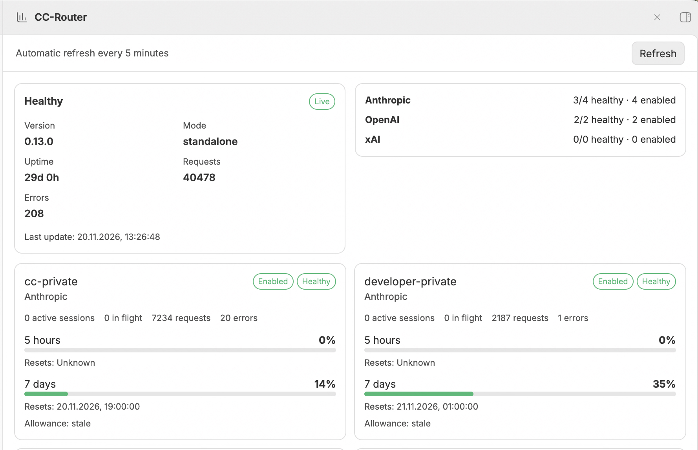

# CC-Router for BB

[](https://github.com/nodueck/bb-plugin-cc-router/actions/workflows/ci.yml)
[](LICENSE)


A BB extension that keeps [CC-Router](https://github.com/Timo972/cc-router) visible while you work: router health, every account's allowance usage, and the account each thread is running on.



## What it shows

**The CC-Router page** — router health, version, uptime and totals, a provider summary, and a card per account with its 5-hour and 7-day (or Codex) usage windows, reset times, sessions, and state.

**A sidebar badge** such as `4/6` — how many accounts can take requests right now. It turns orange when some accounts are exhausted, cooling down, or unhealthy, and red when none are ready or the router is unreachable.

**A thread header button** such as `main-account · 5%` — the account the current Claude Code or Codex thread runs on, and its highest current usage. Click it to open the CC-Router page. BB collects every plugin's header button into one split button, so when another plugin also shows one (such as Git's Commit), this one may sit in that button's menu.

## How the thread mapping works

The thread's account is the exact CC-Router session binding; the extension never guesses from logs.

CC-Router forgets a binding an hour after its last request, so the extension also records the account when each turn ends. An idle thread then shows its last account, greyed out, as `main-account · 5% · last`.

| Thread state | Button |
| --- | --- |
| Bound to an account | `main-account · 5%` |
| Idle, binding expired | `main-account · 5% · last` |
| Never routed through CC-Router | `CC-Router: idle` |
| New, no request sent yet | `CC-Router: no session yet` |
| Another provider | `CC-Router: not mapped` |

Status refreshes every five minutes; **Refresh** reloads it immediately.

## Requirements

- BB 0.49 or newer.
- CC-Router 0.13.1 or newer, listening on `http://127.0.0.1:3456` on the same machine as BB. Older versions show status but cannot map threads to accounts.
- Claude Code or Codex threads routed through CC-Router.

## Install

```bash
bb plugin install git:github.com/nodueck/bb-plugin-cc-router.git@main
```

Reload the BB window afterwards.

## Develop

```bash
npm install --legacy-peer-deps
npm test
npm run typecheck
bb plugin build
bb plugin install . --yes
```

After changes, `bb plugin build && bb plugin reload cc-router`.

## Thanks

This extension is only a window onto CC-Router. The routing, token rotation, and allowance tracking it displays are the work of its [maintainers and contributors](https://github.com/Timo972/cc-router/graphs/contributors) — thank you.

## License

MIT
